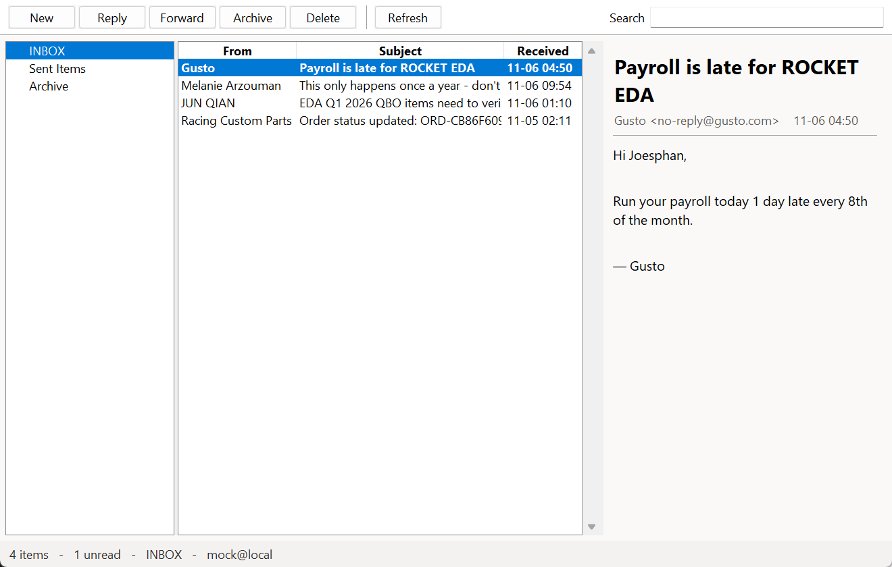

# outlook-desktop

A desktop mail client with the familiar mail-app shape: command bar, folder pane, message list, reading pane, status bar. Read-only, no ad slot, no upsell row, no telemetry.



Screenshot is the built-in mock mailbox, so it renders without an account or credentials.

## Status

| Check | Result |
|---|---|
| `python tests/ui_test.py` — builds the real window against the mock server | **11/11 pass** |
| `--mock` launches a window and renders a mailbox | verified by screenshot above |
| TLS + IMAP handshake with `outlook.office365.com`, `imap.gmail.com` | verified |
| Reading your own mailbox | needs an account (§Add an account) |

## Requirements

Python 3.10+ with tkinter (included in the python.org Windows installer). No `pip install`.

## Run

```powershell
cd outlook-desktop
python -m outlook_client                     # your first account
python -m outlook_client --mock              # canned mailbox, no credentials
python -m outlook_client --account gmail     # pick by name or address
python -m outlook_client --setup             # add / replace an account
python -m outlook_client --mock --screenshot shot.png   # render, grab, exit
```

Keys: `F5` refresh, `Ctrl+F` search box, `Esc` clear search. Click a folder to switch, click a message to read it.

## Add an account

The window handles it: **`--setup`** opens a dialog (or it opens by itself when no accounts exist). Type the address; the provider is detected from the domain and the form asks only for what that provider needs.

| Address | Asked for |
|---|---|
| `@outlook.com`, `@hotmail.com`, `@live.com` | application (client) ID, once |
| `@gmail.com`, `@googlemail.com` | Google app password |
| anything else | IMAP host and password |

Accounts land in `%LOCALAPPDATA%\outlook-desktop\config.json`.

### The one Microsoft requirement

Microsoft's servers advertise `AUTH=XOAUTH2 LOGINDISABLED`, so passwords and app passwords are refused — only OAuth works. A third-party client cannot sign in as Microsoft's own application (that registration belongs to Outlook), so the device-code flow needs an application ID you own:

1. <https://portal.azure.com> → **Microsoft Entra ID** → **App registrations** → **New registration**
2. Account types: **Accounts in any organizational directory and personal Microsoft accounts**
3. **Authentication** → **Allow public client flows** → **Yes** → **Save**
4. Paste the **Application (client) ID** into the form

No secret, no redirect URI. Sign-in happens once in the browser; the refresh token is cached under `%LOCALAPPDATA%\outlook-desktop\`.

Gmail needs nothing from Microsoft.

## What this is not

- **Not a pixel-for-pixel clone.** The three-pane arrangement is standard mail-app furniture; Microsoft's icons, artwork, brand assets and Segoe UI files are not included or reproduced — they are Microsoft's property.
- **Not a full mail client yet.** No compose, reply, forward, delete, move, calendar, contacts, or rules. Folders open read-only (`EXAMINE`), so nothing on the server is modified.
- **No HTML rendering.** Bodies are reduced to text: `text/plain` when present, otherwise HTML is stripped of tags and entities.
- **One account per window.**

## Design notes

- **Threading**: IMAP runs on a worker thread; results are delivered through a `queue.Queue` drained by `after()` on the main thread. Calling `after()` directly from a worker raises *"main thread is not in main loop"* — this was a real crash, now covered by the UI test.
- **DPI**: the process is per-monitor DPI aware, otherwise Tk reports logical pixels and window geometry disagrees with screen captures on scaled displays.
- **Mock server included** (`outlook_client/mock_imap.py`): a small IMAP implementation covering only the commands this client issues, so the whole window can be exercised without an account.
- **Body extraction** fetches the full RFC 822 message and walks the MIME tree, preferring `text/plain` and falling back to stripped HTML.

## License

MIT — see [LICENSE](LICENSE). No Microsoft code or assets are included.
